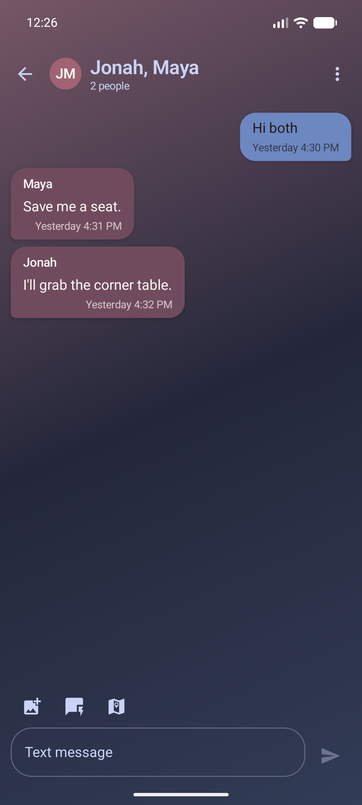
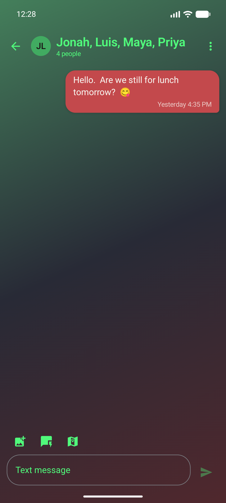
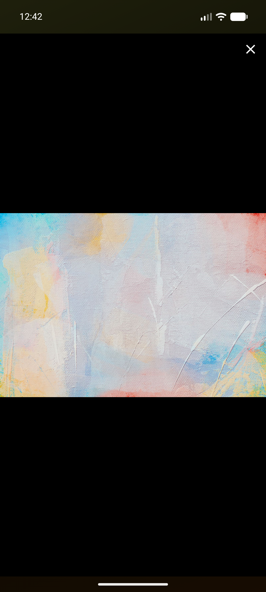
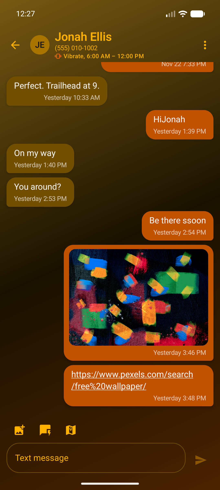
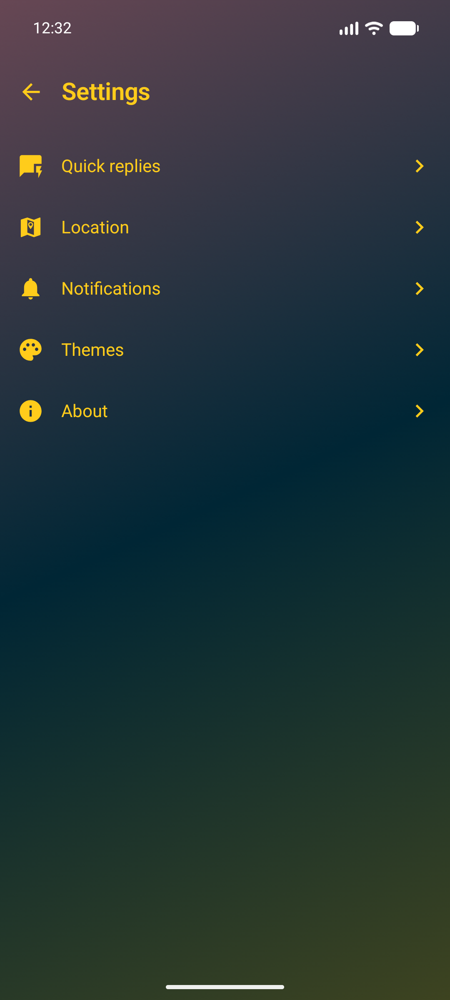
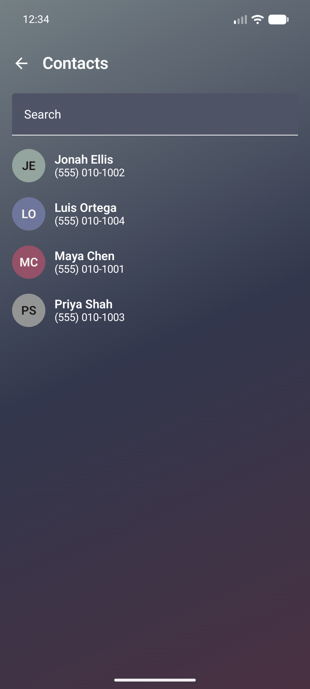
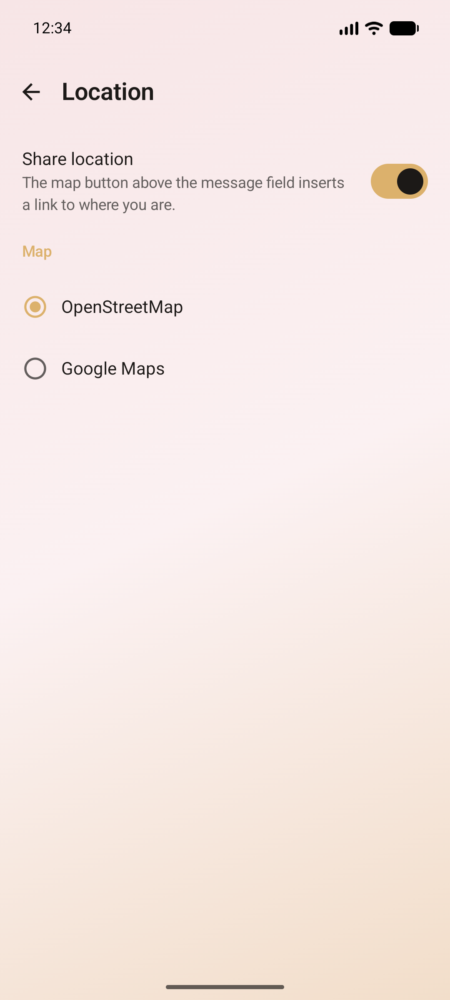
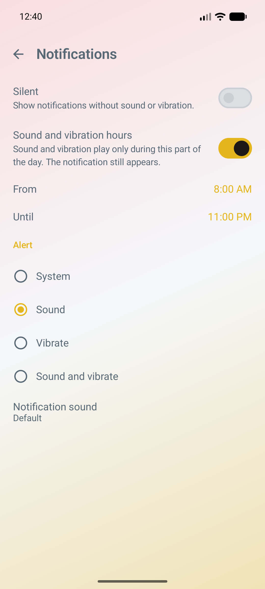

Steamboat is an Android messaging app.  It's goal is style and simplicity.

## Features

- Inbox of one-to-one and group threads, with contact photos and a steamboat mark beside the title.
- Search through message history. Each match is its own row, newest first, with the term highlighted. Opening a result scrolls to that message.
- Conversations with photo and video attachments. One message can hold several images until they reach the carrier’s MMS size limit. An incoming photo or video is downloaded and shown in the thread, with an inline preview and a full-screen viewer.
- Links in a message open in the browser.
- Location sharing. When location is allowed, the map button inserts an OpenStreetMap or Google Maps link at the cursor. The choice is in Settings.
- Group threads. Pick several people from Contacts, add or remove people from the header, and see each incoming sender’s name on their bubble. A group goes out as MMS.
- Quick replies. The first two phrases sit on a new-message notification, and the same list fills the composer from the thread. Saved phrases are 15 characters or less. A typed reply can be up to 143.
- Notifications. Choose silent, or sound, vibration, both, or the system default. Pick the notification sound, and limit sound and vibration to part of the day. A conversation can override the app-wide settings. The icon after Messages shows the app-wide choice, and a custom thread shows its own icon in the list and under the name.
- Themes. Each palette is a three-stop gradient, with text chosen from the palette so it stays readable. System follows the device theme. The palettes included with the app are installed into the theme library, and a theme whose framework version does not match the app stays hidden until it is updated.
- Settings for quick replies, location, notifications, themes, and about. About links to the creator, the source repository, and the GPLv3 license.

Steamboat reads whether RCS is registered. Android’s public API does not offer a way to send RCS, so a text message is sent as SMS, and a photo, video, or group message is sent as MMS.

## Screenshots

Each screen uses a different theme.

Inbox, conversations, composing, search, and settings

### Inbox

Steamboat. The icon after Messages is the app-wide notification setting.


### Group conversation

Catppuccin Macchiato. Jonah and Maya.



### Larger group

Dracula. Jonah, Luis, Maya, and Priya.



### Photo in a thread

Everforest Light Hard Lost. Maya Chen.


### Photo viewer

Medallion.



### Link in a thread

Amber CRT Retro. Jonah Ellis, with a custom vibrate schedule.



### Composing a photo and a location

Base2Tone Lake. Luis Ortega. The photo and OpenStreetMap link are in the draft and were not sent.


### Search

Nordfox. Message excerpts, with the match highlighted.


### Settings

Atlas.



### Quick replies

Seafoam Pastel.


### Themes

Matrix.


### Contacts

Blue Moon Light.



### Location

Cupcake.



### Notifications, silent

Doom One. Silent is on, and sound and vibration are limited to part of the day.


### Notifications, with sound hours

Solarflare Light. Silent is off, sound is selected, and the hours run from 8:00 AM to 11:00 PM.



### Conversation notification settings

Synthwave Everything. Maya Chen, with a custom silent setting and the clue under her name.


## Build

JDK 21, Android SDK 37. `minSdk` is 29. The version name is 1.0.0.

```sh
export JAVA_HOME=/usr/lib/jvm/java-21-openjdk-amd64
./gradlew :app:installDebug
```

## Permissions

Steamboat asks for these permissions. SMS is granted by making Steamboat the default SMS app. The others are ordinary Android permission prompts.

**SMS.** `READ_SMS`, `RECEIVE_SMS`, and `SEND_SMS` let Steamboat read the existing message history, receive new texts, and send texts.

**MMS.** `RECEIVE_MMS` and `RECEIVE_WAP_PUSH` let Steamboat receive a photo or video. The carrier push is downloaded and shown in the thread. A photo, video, or group message is sent as MMS.

**Contacts.** `READ_CONTACTS` supplies names, numbers, and photos for the inbox and the contact picker. `WRITE_CONTACTS` is requested on the same prompt. The emulator sample inbox uses it to add its people.

**Notifications.** `POST_NOTIFICATIONS` on Android 13 and later lets a new message appear in the shade, including quick reply.

**Location.** `ACCESS_FINE_LOCATION` and `ACCESS_COARSE_LOCATION` are used by the map button. An approximate grant is enough to insert a map link. Location sharing can be turned off in Settings.

**Photos.** `READ_MEDIA_IMAGES` and `READ_MEDIA_VIDEO` (or photo access on older Android) let the chooser see each file’s size. An image that would push the message past the carrier MMS limit cannot be selected.

## Sideloading

An APK installed from a file is a sideloaded app. Steamboat asks to send and receive SMS, and Android holds that permission back until you allow it. Two Google protections get in the way.

**Google Play Protect** can refuse the install. Open the Play Store, tap your profile picture, then **Play Protect**, then the settings gear, and turn off **Scan apps with Play Protect**. Install the APK. If a scan still blocks it, open **More details** and choose **Install anyway**. Turn scanning back on after Steamboat is installed.

**Allow restricted settings** is required before SMS can be granted. On Android 13 and later, the SMS permission screen says **App was denied access** and **Allow** stays disabled.

1. Open **Settings → Apps → Steamboat → Permissions → SMS** and tap the disabled **Allow** control. That records the restriction so the next menu item appears.
2. Go back to the Steamboat app info screen, open the **⋮** menu, and tap **Allow restricted settings**. Confirm with your PIN, pattern, or fingerprint.
3. Open **Permissions → SMS** again and tap **Allow**.
4. In Steamboat, tap **Use Steamboat for SMS** and accept the system prompt. New messages are delivered to the default SMS app.

## Sample data

`testdata/` holds a small inbox and three wallpapers for the emulator.

```sh
./testdata/load-emulator.sh
./testdata/load-images.sh
```

The inbox script writes contacts and threads. The image script copies the wallpapers into the photo library.

## Thanks

- [Pexels](https://www.pexels.com/) for the test images.
- [Gogh](https://gogh.website/) for the theme inspirations.
